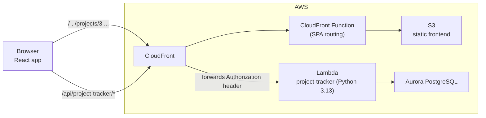
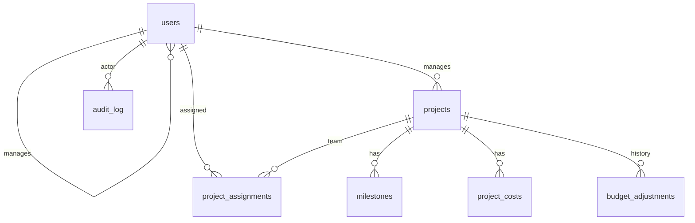

# ACME Project Tracker

A full-stack project management platform for ACME Inc. It gives admins, managers, and employees one place to track project status, milestones, team assignments, hours, and budgets.

**Live app:** https://d1s9flaq6nnkhh.cloudfront.net (login details are provided separately)

| | |
|---|---|
| **Frontend** | React 19 + Vite, Material UI, React Router, react-responsive |
| **Backend** | Python 3.13 on AWS Lambda (one service, plain handler with a small router) |
| **Database** | PostgreSQL (local) / Amazon Aurora PostgreSQL 17 (AWS) |
| **Infrastructure** | Terraform: Lambda Function URLs, Aurora, S3, CloudFront |
| **Tests** | pytest (89 tests, 82% coverage) and Vitest + React Testing Library (42 tests) |

---

## Contents

1. [Features](#features)
2. [How requirements are met](#how-requirements-are-met)
3. [Architecture](#architecture)
4. [Project structure](#project-structure)
5. [Data model](#data-model)
6. [API reference](#api-reference)
7. [Running locally](#running-locally)
8. [Deploying to AWS](#deploying-to-aws)
9. [Testing](#testing)
10. [Security](#security)
11. [Design decisions and trade-offs](#design-decisions-and-trade-offs)
12. [Problems found and fixed](#problems-found-and-fixed)
13. [Known limitations and next steps](#known-limitations-and-next-steps)

---

## Features

### By role

| Feature | Admin | Manager | Employee |
|---|:-:|:-:|:-:|
| Dashboard with project status, progress, and at-risk flags | ✅ all projects | ✅ own projects | ✅ assigned projects |
| Create projects and assign their manager | ✅ | | |
| Edit project details and adjust the budget (with a reason) | ✅ | ✅ own projects | |
| Milestones: create, edit, complete | ✅ | ✅ own projects | view only |
| Assign employees individually or a whole team | ✅ | ✅ own projects | |
| Track other costs (technology, licenses, travel...) | ✅ | ✅ own projects | |
| Mark projects done / reopen | ✅ | ✅ own projects | |
| Archive and restore projects and users | ✅ | | |
| Create users (admins, managers, employees) | ✅ | | |
| Edit users | ✅ everyone | ✅ name and email of own team | own name only |
| Team workload view (weekly hours, over-allocation) | ✅ | ✅ | |
| Audit log of every change | ✅ | | |
| Change own password, dark mode | ✅ | ✅ | ✅ |

Employees see progress and hours but never money (rates, costs, or budgets), because on a small team, budget spent divided by hours worked would reveal individual pay.

### Highlights

- **Archive instead of delete.** Projects and users are never deleted, only archived, and admins can restore them.
- **Hours and budget tracked automatically.** Assignments define hours per day and dates (8 h/day, Monday–Friday). Cost is hours × each employee's hourly rate, and "spent" grows day by day as work happens.
- **40-hour week enforced.** An employee can't be booked for more than 8 hours/day across overlapping active projects.
- **Projects finish only when every milestone is complete.**
- **Tamper-proof audit log.** Every change is recorded with who, when, and before/after values; database triggers block edits and deletes.
- **Responsive and accessible.** Tables become cards on phones, the menu becomes a drawer, there's a dark mode that follows the device setting, and every icon button and progress bar has a text label.

---

## How requirements are met

### Minimum requirements

| Requirement | Implementation |
|---|---|
| 3 roles | `admin`, `manager`, `employee`, enforced on every endpoint with `@require_auth(...)` and in the UI |
| Project start/end dates | Validated (end ≥ start) in the API and by a database `CHECK` constraint; assignments and milestones must fall inside them |
| Milestones | Status (not started → in progress → complete), dates, completion timestamp; the project can be marked done only when all are complete |
| Managers add employees to projects | Individually or a manager's whole team, with the 40-hour check |
| Admins create managers, employees, projects | 6-character usernames are generated automatically |
| Archive projects and employees | `is_archived` flag; `DELETE` endpoints archive instead of deleting; admins can restore |
| Deployed to AWS | Lambda + Aurora + S3 + CloudFront via the workshop's Terraform and scripts |

### Other requirements from the brief

| Requirement | Implementation |
|---|---|
| Employees can only have one manager | `users.manager_id`; required for employees, must be an active manager |
| A project always needs a manager | `projects.manager_id NOT NULL`; managers with active projects or employees can't be archived or demoted until reassigned |
| Only admins see archived projects | Enforced in the SQL that loads projects, not just the UI |
| Starting budget; employees are paid as they work | `budget` per project; "spent" = hours worked to date × hourly rate |
| Managers can adjust the budget | Every change is stored in `budget_adjustments` with old/new amounts, who, and why |
| Status bars for active and done projects | Milestone progress and budget bars on the dashboard, project cards, and detail page |
| **Stretch goal:** other costs like technology | `project_costs` with categories; past-dated costs count as spent, future-dated as committed |

### Business questions answered

| Question | Where |
|---|---|
| What is the status of each active project? | Dashboard and Projects page: status, milestone progress, hours |
| Which projects are at risk of missing deadlines? | "Needs attention" section: overdue or over-budget projects |
| How are resources allocated across projects? | Team tab per project; Workload page across projects |
| What are the key deliverables and their status? | Milestones tab |
| Which team members are over-allocated? | Workload page: weekly utilization per person, over-allocation in red |
| How much budget has been consumed vs. planned? | Budget bars, Costs tab, and Budget history tab |

---

## Architecture



**One backend service.** All features live in one Lambda (`backend/project-tracker`), organized by feature inside it. Terraform packages each service folder separately, so a single service makes it easy to share code (routing, auth, validation, database access) without copying it.

**Local vs. cloud**

| | Local | AWS |
|---|---|---|
| Frontend | Vite dev server on `localhost:3000` | S3 behind CloudFront |
| API entry | CORS proxy on `localhost:3001` (`bin/proxy-server.js`) | CloudFront `/api/project-tracker*` behavior |
| Lambda | LocalStack | AWS Lambda (Function URL) |
| Database | PostgreSQL 18 on the WorkSpace | Aurora PostgreSQL 17 |

The frontend always calls `${VITE_API_URL}/api/project-tracker/...`, so the same code works in both environments.

### Backend request flow

1. `function.py` → `handler(event)` runs `ensure_schema()` once per container (idempotent, under a PostgreSQL advisory lock).
2. `core/http.py` normalizes the path (strips `/api/project-tracker`) and routes to a handler.
3. `@require_auth(...)` verifies the JWT, reloads the user from the database (so archiving or role changes apply immediately), and checks the role.
4. The handler validates input with `core/validation.py`, runs SQL inside `db.transaction()`, writes an audit entry in the same transaction, and returns JSON.

### Frontend structure

- `services/api.js`: the only place that talks to the backend. It adds the token, refreshes it on 401 and retries, retries once on 503, and turns errors into readable messages with per-field details.
- `services/endpoints.js`: one named function per endpoint.
- `context/`: login state and color mode, shared app-wide.
- `hooks/useApiData.js`: loading/error/data state with protection against stale responses.
- Shared components (`ConfirmDialog`, `PageHeader`, `LoadingState`, `ErrorState`, `EmptyState`) give every page the same loading, error, empty, and success feedback.

---

## Project structure

```
backend/
├── project-tracker/              # The Lambda service (deployed)
│   ├── function.py               # Entry point: registers routes, handles errors
│   ├── core/                     # Shared infrastructure
│   │   ├── app.py                #   Shared router instance
│   │   ├── http.py               #   Router, request parsing, JSON responses
│   │   ├── db.py                 #   Connection, transactions, schema setup, retries
│   │   ├── schema.sql            #   Tables, constraints, indexes, views, triggers
│   │   ├── seed.py               #   Default admin and JWT secret
│   │   ├── security.py           #   Password hashing, username generation
│   │   ├── auth.py               #   JWTs and @require_auth(...)
│   │   ├── validation.py         #   Reusable Validator
│   │   └── audit.py              #   Audit log helpers
│   ├── api/                      # One module per feature
│   │   ├── auth.py  users.py  projects.py  assignments.py
│   │   └── milestones.py  costs.py  workload.py  audit_log.py
│   └── requirements.txt          # psycopg[binary], PyJWT
└── tests/                        # pytest (not deployed)
    ├── conftest.py               # Fresh test database, API client, fixtures
    └── test_*.py

frontend/src/
├── services/                     # api.js, endpoints.js
├── context/                      # Auth and color-mode providers
├── hooks/                        # useApiData, useDebouncedValue
├── components/                   # Layout, route guard, shared UI
│   ├── projects/                 # Cards, indicators, tabs, and dialogs for projects
│   └── users/                    # User form dialog
├── pages/                        # Login, Dashboard, Projects, ProjectDetail, Users,
│                                 # Workload, Archive, AuditLog, Profile
├── utils/                        # format.js, audit.js, assignments.js
└── theme.js                      # Light and dark themes

infra/                            # Workshop Terraform (cloudfront.tf modified, see below)
bin/                              # Workshop scripts (+ run-tests.sh; proxy-server.js modified)
```

---

## Data model



| Table | Purpose |
|---|---|
| `users` | All three roles in one table. `manager_id` points to the employee's single manager. `username` is exactly 6 characters. |
| `projects` | `manager_id NOT NULL`; `status` (active/done) and `is_archived` are separate lifecycle stages. |
| `project_assignments` | Many-to-many link with `hours_per_day` (0 < h ≤ 8) and dates; `UNIQUE (project_id, user_id)`. |
| `milestones` | Dates, status, and `completed_at`. |
| `project_costs` | Non-labor costs by category and date. |
| `budget_adjustments` | Append-only history of budget changes. |
| `audit_log` | Append-only change history (JSONB before/after), protected by triggers. |
| `app_settings` | Key-value settings; holds the JWT signing secret. |
| `assignment_costs` (view) | Planned and worked hours per assignment: weekdays × hours/day; "worked" stops at today. |

Rules live in the database as well as the API (`NOT NULL`, `UNIQUE`, `CHECK`, foreign keys), so invalid data can't be stored even if application code has a bug. Money uses `NUMERIC` (exact) rather than floating point.

---

## API reference

Base URL: `http://localhost:3001/api/project-tracker` (local) or `https://<cloudfront-domain>/api/project-tracker` (AWS). All endpoints except login, refresh, and health need `Authorization: Bearer <access token>`.

| Method | Endpoint | Who | Description |
|---|---|---|---|
| GET | `/health` | anyone | Database connectivity check |
| POST | `/auth/login` | anyone | Username + password → user, access token (30 min), refresh token (7 days) |
| POST | `/auth/refresh` | refresh token | New tokens |
| GET / PUT | `/auth/me` | logged in | Own profile; update own first/last name |
| POST | `/auth/change-password` | logged in | Requires the current password |
| GET / POST | `/users` | admin, manager / admin | List (search, role, status, `manager_id=me`) / create |
| GET / PUT | `/users/{id}` | see rules | View / edit (managers: own team, name and email only) |
| DELETE | `/users/{id}` | admin | Archive |
| POST | `/users/{id}/unarchive` | admin | Restore |
| GET / POST | `/projects` | all (filtered) / admin | List (search, status, `manager_id`, `archived`) / create |
| GET / PUT | `/projects/{id}` | all (filtered) / admin, manager | View with stats / edit (budget changes logged) |
| DELETE | `/projects/{id}` | admin | Archive |
| POST | `/projects/{id}/complete` · `/reopen` · `/unarchive` | admin, manager / admin | Lifecycle |
| GET | `/projects/{id}/budget-history` | admin, manager | Budget changes |
| GET / POST | `/projects/{id}/assignments` | all / admin, manager | Team list / add one person |
| POST | `/projects/{id}/assignments/team` | admin, manager | Assign a manager's whole team |
| PUT / DELETE | `/projects/{id}/assignments/{assignment_id}` | admin, manager | Edit / remove |
| GET / POST | `/projects/{id}/milestones` | all / admin, manager | List / create |
| PUT / DELETE | `/projects/{id}/milestones/{milestone_id}` | admin, manager | Edit (incl. status) / delete if not started |
| GET / POST | `/projects/{id}/costs` | admin, manager | List / add cost |
| PUT / DELETE | `/projects/{id}/costs/{cost_id}` | admin, manager | Edit / delete |
| GET | `/workload` | admin, manager | Weekly hours per employee (`start`, `weeks`, `manager_id`) |
| GET | `/audit-log` | admin | Change history (`entity_type`, `action`, `actor_id`, `project_id`, `search`, cursor `before`) |

**Status codes:** 200 OK, 201 Created, 204 No Content, 400 validation error, 401 not logged in, 403 not allowed, 404 not found (also used for records the user isn't allowed to see), 405 wrong method, 409 conflict with a business rule, 503 database starting up, 500 unexpected error.

**Error format:**

```json
{ "error": "Validation failed", "details": { "email": "is already in use", "end_date": "must be on or after start_date" } }
```

---

## Running locally

### Prerequisites

The workshop WorkSpace (Ubuntu) with Docker, LocalStack, PostgreSQL, Terraform, the AWS CLI, Node.js, and **Python 3.13** (`./bin/setup-environment.sh` installs these).

### 1. Install backend libraries

The Lambda runs **Python 3.13 on x86_64**. On the WorkSpace, the default `pip` belongs to Python 3.14, which would install the wrong build of `psycopg`. Install for the Lambda's platform explicitly, then mark the install as done so `start-dev.sh` doesn't replace it:

```sh
pip install --target=backend/project-tracker --platform manylinux2014_x86_64 \
  --python-version 3.13 --implementation cp --only-binary=:all: \
  -r backend/project-tracker/requirements.txt
md5sum backend/project-tracker/requirements.txt | cut -d' ' -f1 > backend/project-tracker/.pip_installed
```

### 2. Start everything

```sh
source ~/.bashrc
./bin/start-dev.sh
```

This starts PostgreSQL, LocalStack, the Lambda, the proxy (port 3001), and the frontend (port 3000). Open **http://localhost:3000**.

On first start, the backend creates the tables and a default admin:

| Username | Password |
|---|---|
| `admin1` | `ChangeMe123!` (or the `ADMIN_PASSWORD` environment variable) |

Change it from **My profile** after signing in. Other users are created from the Users page; usernames are generated.

### Useful commands

```sh
# Restart the local Lambda so it loads backend code changes
docker ps -q --filter "name=lambda" | xargs -r docker rm -f

# Restart the proxy if the frontend says "Can't reach the server"
nohup node bin/proxy-server.js > /tmp/proxy-server.log 2>&1 &

# Lambda logs
AWS_ENDPOINT_URL="http://localhost.localstack.cloud:4566" \
  aws logs tail /aws/lambda/coding-workshop-project-tracker-<participant-id> --follow
```

---

## Deploying to AWS

Use a fresh terminal (local testing sets LocalStack variables), then:

```sh
unset AWS_ENDPOINT_URL AWS_ENDPOINT_URL_S3 AWS_ACCESS_KEY_ID AWS_SECRET_ACCESS_KEY AWS_SESSION_TOKEN
source ~/.bashrc
./bin/deploy-backend.sh     # Terraform: Lambda, Aurora, S3, CloudFront (+ fresh temporary credentials)
./bin/deploy-frontend.sh    # Build, upload to S3, invalidate CloudFront
```

The first deployment takes 10–20 minutes; later ones take 1–3 minutes. On first use, the backend creates the schema and default admin in Aurora; **change the admin password immediately** on a public deployment.

Lambda logs in AWS:

```sh
source ENVIRONMENT.config
aws logs tail /aws/lambda/coding-workshop-project-tracker-<participant-id> --since 15m --region us-east-2
```

---

## Testing

### Run everything

```sh
./bin/run-tests.sh
```

Runs backend tests with coverage, frontend lint, and frontend tests with coverage. HTML reports are written to `coverage/backend/index.html` and `coverage/frontend/index.html`. Local PostgreSQL must be running.

### Backend: pytest

```sh
python3.13 -m pytest backend/tests -v          # every test by name
python3.13 -m pytest backend/tests -k "40_hour" # tests matching a name
```

- A **fresh test database** (`project_tracker_test`) is created for each run and dropped afterwards; the app builds its own schema in it, so the real schema, constraints, view, and triggers are tested.
- **Unit tests** cover password hashing, the validator, the router (including the `/api` prefix fix), JSON formatting, and audit diffs.
- **Integration tests** call the real Lambda `handler()` with AWS-shaped events: authentication and token misuse, role-based access for all three roles, the 40-hour rule, hours and cost math (checked against an independent weekday count), milestone and completion rules, archiving, costs, workload, and the audit log (including that the database rejects `DELETE`, `UPDATE`, and `TRUNCATE`).
- Each test creates its own uniquely named data, so tests don't interfere with each other.

### Frontend: Vitest + React Testing Library

```sh
cd frontend
npm test                 # run once
npm run test:verbose     # every test by name
npm run test:watch       # rerun on save
npm run coverage
```

- **API client** tests use a fake `fetch`: token header, refresh-and-retry on 401, logout when refresh fails, one retry on 503, network errors, error details, and login not triggering a refresh.
- **Component** tests render real components in jsdom and find elements by label and button name (which also checks accessibility): login validation and errors, route protection by role, confirm dialogs, status and budget indicators, and budget hidden for employees.
- **Utility** tests include a regression test for a time-zone bug (date-only values shown a day early).

### Results

| Suite | Tests | Coverage (lines) |
|---|---|---|
| Backend (pytest) | 89 passed | **82%** |
| Frontend (Vitest) | 42 passed | 16% overall |
| Frontend lint (ESLint) | 0 problems | — |

Frontend tests focus on the code where a bug would do the most damage:

| File | Lines covered |
|---|---|
| `services/api.js` (auth, refresh, retries, errors) | 95% |
| `pages/LoginPage.jsx` | 96% |
| `components/projects/ProjectCard.jsx` | 100% |
| `utils/audit.js` | 100% |
| `utils/format.js` | 87.5% |

The overall frontend figure is low because page-level screens (Projects, Users, Workload, Audit log, and their forms) don't have automated tests yet; they were verified manually.

### Manual end-to-end checks (local and AWS)

Verified in the browser for each role: login and session restore; dashboard per role; project create/edit/budget change with reason; milestones through to project completion and locking; team assignment, the 40-hour message, and removal; costs; archive and restore (including the "choose a new manager" path); user creation with generated usernames; workload and over-allocation; audit log filters and paging; refreshing deep links on CloudFront; "Project not found" for invalid IDs; dark mode; mobile layout.

### Not yet covered

- Page-level frontend tests with mocked API responses (to reach the 80% frontend target).
- Browser end-to-end tests (Playwright or Cypress) for the critical paths.
- Load testing (Artillery or JMeter).
- CI: `./bin/run-tests.sh` could run in GitHub Actions with a PostgreSQL service container.

---

## Security

| Area | Approach |
|---|---|
| Passwords | PBKDF2-SHA256, 210,000 iterations, random salt per password, constant-time comparison; never returned or logged |
| Login errors | One message for wrong username, wrong password, and archived accounts, so usernames can't be discovered |
| Tokens | JWT (HS256): 30-minute access tokens and 7-day refresh tokens with a `type` claim, so neither can be used as the other |
| Session checks | The user is reloaded from the database on every request, so archiving or a role change takes effect immediately |
| Authorization | Centralized in `@require_auth(...)`; visibility rules are part of the SQL; unknown fields are rejected (no privilege escalation through extra fields) |
| Information hiding | Records a user may not see return 404, not 403; employees never receive rates, costs, or budgets |
| SQL injection | All values are parameterized; column names only come from fixed allow-lists |
| Audit trail | Written in the same transaction as each change; append-only enforced by database triggers |

---

## Design decisions and trade-offs

| Decision | Why | Trade-off / production alternative |
|---|---|---|
| Plain Lambda handler with a small router instead of FastAPI | Avoids extra compiled dependencies and Python-version packaging problems in Lambda | Less built-in tooling (no automatic OpenAPI docs) |
| One backend service, organized by feature | Shared code without copying between separately packaged Lambdas | One deployment unit for all features |
| `DELETE` archives instead of deleting | Requirement; keeps history and budget data intact | Archived data grows over time |
| Hours and costs calculated by a database view | Always consistent with the source data; nothing to keep in sync | Recalculated per query; a materialized view or cached totals would scale further |
| Cost uses each employee's **current** hourly rate | Simple and meets the requirement | A raise changes past costs; production would store the rate per assignment or use timesheets |
| Capacity check sums every assignment overlapping the new date range | Can never allow more than 8 h/day | Slightly conservative when overlapping assignments don't overlap each other |
| Removing a started assignment ends it yesterday; past members hidden by default | Keeps worked hours on the budget while freeing the person from today | History is one click away ("Show past members") |
| Schema applied on startup with `IF NOT EXISTS` / `CREATE OR REPLACE` | Same behavior locally and on AWS with no manual setup | Can't alter existing tables; production would use a migration tool (e.g. Alembic) |
| JWT secret generated once and stored in the database | Shared by all Lambda instances without changing the workshop's infrastructure | Database read access would expose it; production would use AWS Secrets Manager (the code already prefers a `JWT_SECRET` environment variable) |
| Tokens stored in `localStorage` | Survive page reloads; simple | Readable by any script on the page (XSS risk); httpOnly cookies are safer |
| Audit log uses cursor pagination | Stays consistent while new entries arrive; fast at any size | No "jump to page N" |

---

## Problems found and fixed

| Problem | Cause | Fix |
|---|---|---|
| Lambda failed to import `psycopg` | The workshop example pins `psycopg-binary` 3.2.3, which has no Python 3.13 build; `start-dev.sh` hides pip errors and marks the install done anyway | Upgraded to 3.2.13 |
| Lambda still failed: "no pq wrapper available" | The default `pip` is Python 3.14, so it installed a 3.14 build | Install with `--platform manylinux2014_x86_64 --python-version 3.13` |
| Logged-in requests failed locally | `bin/proxy-server.js` didn't forward the `Authorization` header | Forward it when present |
| `npm run lint` failed out of the box | `eslint.config.js` imports `eslint-plugin-react-hooks` and `eslint-plugin-react-refresh`, which weren't in `package.json` | Added both as dev dependencies; lint is clean |
| Dates shown a day early | `new Date("2026-10-01")` is midnight UTC (Sept 30 in US time zones) | Build date-only values from their parts in local time (regression test included) |
| Every API route would 404 behind CloudFront | The local proxy strips `/api/project-tracker`, but CloudFront forwards the full path (found by reading `cloudfront.tf` before deploying) | The router strips the prefix in both environments |
| First requests after idle time failed with 500 | CloudWatch logs showed `ConnectionTimeout`: Aurora Serverless resuming from a pause | Short retried connection attempts within CloudFront's 30 s limit, a clear 503 if still unavailable, and one automatic retry in the frontend |
| API 404s returned the HTML page with status 200, and refreshing deep links showed "Access Denied" | The distribution-wide `custom_error_response` rewrote every 404 (including the API's), and a private S3 bucket returns 403 for missing files | Replaced with a CloudFront Function on the website behavior only (paths without a file extension serve `index.html`); verified with `curl` |
| Employees could work out pay rates | Budget spent ÷ hours worked on a one-person project | Budget fields removed from API responses for employees |
| Over-allocation could slip past the capacity check | Reopening or restoring a project brings assignments back without a check | The Workload page calculates from actual data and flags it in red |
| "Remove" seemed to do nothing for started assignments | The end date became today, so the member looked unchanged until tomorrow | End the assignment yesterday and hide past members by default |

---

## Known limitations and next steps

- **No admin password reset.** Users change their own password (current password required). Workaround: create a new account, reassign projects, archive the old one. Next step: an admin reset (or email reset link) recorded in the audit log.
- **Changing a password doesn't sign out other sessions.** Existing tokens remain valid until they expire. Next step: a `password_changed_at` check that invalidates older tokens.
- **No timesheets.** Hours come from assignments (planned hours per day), not from logged actual time.
- **Frontend test coverage** is below target for page-level screens; E2E and load tests are not set up yet (see [Testing](#testing)).
- **Infrastructure changes to the workshop Terraform:** `infra/cloudfront.tf` (SPA routing function). `bin/proxy-server.js` forwards the `Authorization` header; `bin/run-tests.sh` was added.

---

*The original workshop participant guide is in [`docs/WORKSHOP-README.md`](docs/WORKSHOP-README.md).*